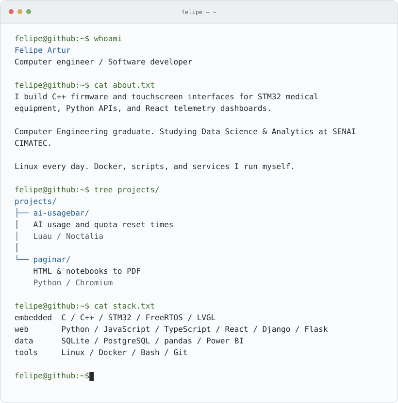

<picture>
  <source media="(prefers-color-scheme: dark) and (max-width: 600px)" srcset="assets/terminal-dark-mobile.svg">
  <source media="(max-width: 600px)" srcset="assets/terminal-light-mobile.svg">
  <source media="(prefers-color-scheme: dark)" srcset="assets/terminal-dark.svg">
  
</picture>

  <a href="https://github.com/noctalia-dev/community-plugins/tree/main/ai-usagebar"><samp>ai-usagebar</samp></a>
  &nbsp;/&nbsp;
  <a href="https://github.com/FelipeArtur/paginar"><samp>paginar</samp></a>
  &nbsp;/&nbsp;
  <a href="https://www.linkedin.com/in/felipeartur/"><samp>linkedin</samp></a>
  &nbsp;/&nbsp;
  <a href="mailto:felipe.artur.ml@gmail.com"><samp>email</samp></a>

Text version & project details

## About

I build software for embedded devices and the systems around them. My work includes C++ firmware and touchscreen interfaces for STM32-based medical equipment, telemetry systems with Python APIs, and React dashboards with authentication and data visualization.

I have a degree in Computer Engineering and I'm studying Data Science & Analytics at SENAI CIMATEC. My data work includes acquisition systems and Power BI dashboards; my postgraduate studies cover statistics, data processing, and machine learning.

Linux is my everyday environment. I run my own services and use Docker and scripts to automate setup and routine tasks.

## Projects

### [`ai-usagebar/`](https://github.com/noctalia-dev/community-plugins/tree/main/ai-usagebar)

A Luau plugin I wrote for Noctalia's bar and panel. It shows AI plan usage and quota reset times, using data from [akitaonrails/ai-usagebar](https://github.com/akitaonrails/ai-usagebar). Available in the official Noctalia plugin registry.

Luau · Noctalia · Linux

### [`paginar/`](https://github.com/FelipeArtur/paginar)

A Python command-line tool I built to turn HTML documents and Jupyter notebooks into PDFs. It uses Chromium and works without LaTeX.

Python · Chromium · PDF

## Technologies

| Area | Technologies I've used |
| :--- | :--- |
| Embedded | `C` `C++` `STM32` `FreeRTOS` `LVGL` |
| Web & APIs | `Python` `JavaScript` `TypeScript` `React` `Django` `Flask` |
| Data | `SQLite` `PostgreSQL` `pandas` `Power BI` |
| Environment | `Linux` `Docker` `Bash` `Git` |

